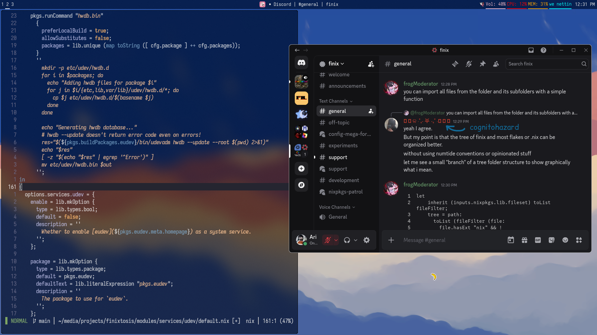
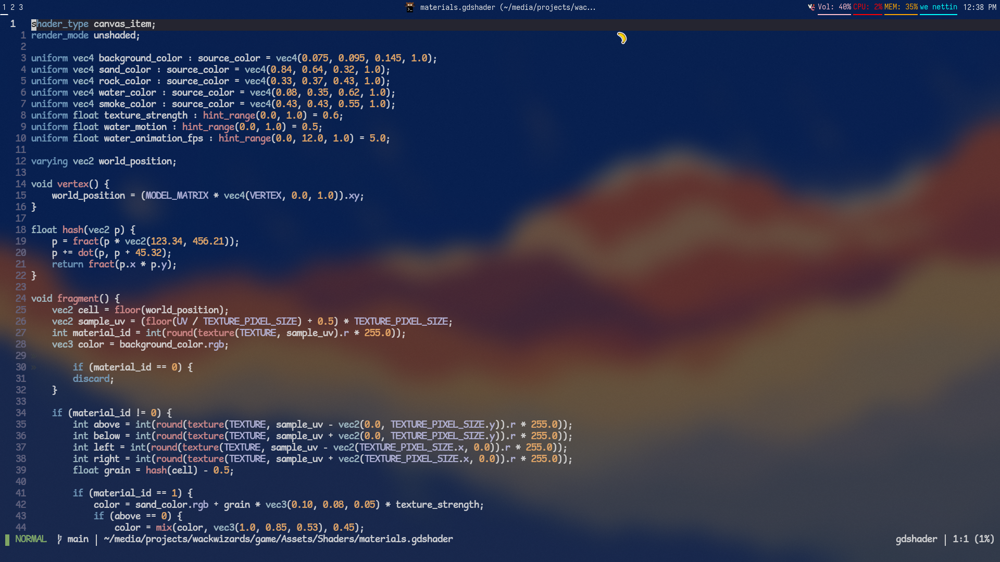

# finix with that fast init finit nix finit

- Single host
- Uses [lon](<https://github.com/nikstur/lon>) for locking (completely unremarkable choice)
- Uses [hjem](<https://github.com/feel-co/hjem>) to manage my home directory
- Niri, Waybar and kitty (also try [foot](<https://codeberg.org/dnkl/foot>)!)
- Has remnants of wrappers

>[!WARNING]
>Using your desktop like this should be a crime, imo. This is a showcase. Turn that opacity up, remove animations, tighten your gaps. Please.

# Screenshots

-----

Huge thanks to:
- [aanderse](<https://github.com/aanderse>), creator of [Finix](<https://github.com/finix-community/finix>)
- [Jager](<https://github.com/dmkhitaryan/>)
- [r0chd](<https://github.com/r0chd/>)
- [llakala](<https://github.com/llakala/>)
